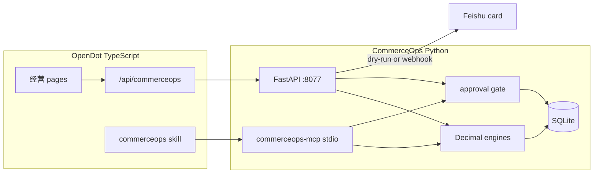
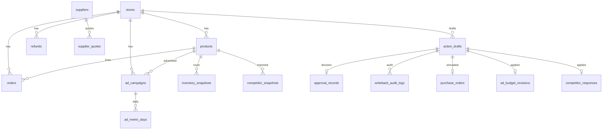

# CommerceOps AI final delivery

This is the interview release of CommerceOps on OpenDot. The Python service
owns the numbers. OpenDot owns login, the 经营 pages, the project skill, and
the human approval click. A model is not called by the engines, the weekly
report, or the eval bench.

## Architecture



OpenDot decides who may call a tool. CommerceOps decides whether a business
write is legal. Draft tools do not change a budget, a purchase order, or a
competitor snapshot. `commerceops_approve_and_execute_draft` is the only apply
path. Repeating it returns the same `execution_ref` and writes `replay_noop`.

## Directory

```text
services/commerceops/
  Dockerfile
  commerceops/
    api/app.py                 FastAPI
    engines/                   pure Decimal formulas, no SQL
    weekly_report.py           JSON + Markdown + Feishu card
    mcp_server.py              stdio tools
    governance.py              drafts, approval, audit
    evals/bench.py             14 cases, no model
  evals/scorecard.json         committed result of this release
  evals/scorecard.html
  tests/
container/skills/commerceops/SKILL.md
src/routes/commerceops.ts      authenticated proxy, 503 when 8077 is down
web/src/pages/commerce/        概览, 审批, 评测
docker-compose.commerceops.yml
scripts/start-commerceops.sh
.env.commerceops.example
```

## Database

Money columns use `ExactNumeric`: a decimal string on SQLite, not `REAL`.
Reports sum in Python. `writeback_audit_logs` rejects update and delete.
`purchase_orders.sent_to_supplier` cannot be set. A purchase order is simulated
and is not sent to a supplier.



Demo clock, fixed by the seed and safe to run again:

| Item                | Value                                    |
| ------------------- | ---------------------------------------- |
| As of               | 2026-03-15                               |
| Current window      | 2026-03-08 .. 2026-03-14                 |
| Previous window     | 2026-03-01 .. 2026-03-07                 |
| us-main net profit  | 682.60, previous 1371.90, bridge -689.30 |
| uk-main net profit  | 126.00 GBP in both windows               |
| Stock under 14 days | NS-CABLE-3PK, NS-LAMP-LED                |
| Cable supplier rank | SUP-SZR, SUP-VNF, SUP-NBV                |

Re-seeding upserts those keys. It does not delete drafts or audits.

## Formula catalog

`GET /api/v1/formulas` returns the same versions.

| Version       | Rule                                                                                                                                                                                                                                                                                                                                                                                                                                                                                                                 |
| ------------- | -------------------------------------------------------------------------------------------------------------------------------------------------------------------------------------------------------------------------------------------------------------------------------------------------------------------------------------------------------------------------------------------------------------------------------------------------------------------------------------------------------------------- |
| profit.v1     | `net_sales = revenue - discounts - refunds`. `net_cogs = cogs - recovered_cogs`. `net_profit = net_sales - net_cogs - platform_fees - shipping_fees - ad_spend - other_fees`. Margin is null with status `zero_net_sales` when net sales are 0. Ad spend comes only from `ad_metric_days`. The eight bridge contributions equal the profit delta.                                                                                                                                                                    |
| ads.v1        | ACOS, ROAS, TACOS, CTR, CPC, CVR, CPA. A zero denominator is a status, not 0. Budget ladder: ACOS >= 0.80 → 0.50, ACOS >= 0.40 → 0.70, else spend-up and CVR-down → 0.80, else no draft.                                                                                                                                                                                                                                                                                                                             |
| inventory.v1  | `available = max(on_hand - reserved, 0)`. Days of cover is null with `undefined_no_velocity` when velocity is 0. Refunds are not removed from demand. Suggested units are the ceiling of the need. MOQ is not applied here.                                                                                                                                                                                                                                                                                          |
| supplier.v1   | `landed = unit_price * (1 + duty_rate) + freight_per_unit`. Score weights 0.40 cost, 0.25 lead, 0.20 MOQ fit, 0.15 on-time. On-time is used only when `sample_size >= 8`.                                                                                                                                                                                                                                                                                                                                            |
| competitor.v1 | Price drop at or below -3%, BSR rank number improved by at least 200, rating drop of at least 0.2, complaint hits up by at least 10. Rows are imported. A scrape source is rejected.                                                                                                                                                                                                                                                                                                                                 |
| price_sim.v1  | `scale = target_price / current_list_price`. Net sales and platform fees scale with price. COGS, shipping, and other fees stay per unit. `volume_multiplier = max(0, 1 + elasticity * price_change_ratio)`. Elasticities are conservative -1.6, base -1.0, optimistic -0.4. Optimistic means less elastic. Ad spend stays at the observed window total. Unit margin and break-even ACOS are the contribution ratio at the target price. No units is `zero_units`. A negative contribution is `negative_unit_margin`. |
| sop.bm25.v1   | BM25, k1 1.5, b 0.75, Latin words and CJK bigrams. A hit returns `doc_id`, `section`, and a quote that is an exact slice of the markdown file.                                                                                                                                                                                                                                                                                                                                                                       |
| weekly.v1     | Assembly only. It copies the engines above into JSON, Markdown, and a Feishu card. It does not add a cross-currency total and it does not call a model.                                                                                                                                                                                                                                                                                                                                                              |

Bottle list price 20.00 to target 18.00 on the current US window, base scenario:

| Output                                  | Value                      |
| --------------------------------------- | -------------------------- |
| New unit margin                         | 167.9 / 669.6              |
| Break-even ACOS                         | the same ratio             |
| Profit delta                            | -40.81                     |
| Conservative / base / optimistic deltas | -30.736 / -40.81 / -50.884 |
| Scenario units                          | 64.96 / 61.6 / 58.24       |

A price cut loses money here because unit contribution falls faster than the
volume response, and ad spend does not shrink. The optimistic row loses more
on a cut because volume rises less.

## HTTP and MCP

The OpenDot proxy requires a login cookie and forwards to
`COMMERCEOPS_API_URL` (default `http://127.0.0.1:8077`). If that process is
down the proxy returns 503 `commerceops_offline`. `GET /api/commerceops/meta`
stays inside OpenDot.

| Action                                                      | HTTP                                                                                      | MCP tool                                                                                                                                                                                                       |
| ----------------------------------------------------------- | ----------------------------------------------------------------------------------------- | -------------------------------------------------------------------------------------------------------------------------------------------------------------------------------------------------------------- |
| Health and formula versions                                 | `GET /health`                                                                             |                                                                                                                                                                                                                |
| Formula catalog                                             | `GET /api/v1/formulas`                                                                    |                                                                                                                                                                                                                |
| Stores, profit, ads, inventory, suppliers, competitors, SOP | `GET /api/v1/...`                                                                         | `commerceops_list_stores`, `commerceops_profit_report`, `commerceops_ads_diagnosis`, `commerceops_inventory_risk`, `commerceops_supplier_comparison`, `commerceops_competitor_diff`, `commerceops_search_sops` |
| Price simulation                                            | `POST /api/v1/price-simulations`                                                          | `simulate_price_change`                                                                                                                                                                                        |
| Weekly report                                               | `POST /api/v1/reports/weekly`                                                             | `generate_weekly_report`                                                                                                                                                                                       |
| Drafts                                                      | `POST /api/v1/ads/budget-drafts`, `/purchase-order-drafts`, `/competitor-response-drafts` | `commerceops_create_*_draft`                                                                                                                                                                                   |
| Approve once                                                | `POST /api/v1/drafts/{id}/approve-and-execute`                                            | `commerceops_approve_and_execute_draft`                                                                                                                                                                        |
| Bare execute                                                | `POST /api/v1/drafts/{id}/execute` returns 409 `unapproved_execution`                     | not exposed                                                                                                                                                                                                    |

`target_price` is a decimal string from the browser through JSON into
`Decimal`. Floats are rejected. `generate_weekly_report` defaults
`push_feishu` to false so an agent does not send a card unless asked. The
概览 button sends `push_feishu: true`. With no `FEISHU_WEBHOOK_URL` the mode
is `dry_run` and the same card is stored.

## Verified results from this run

Eval bench, generated 2026-11-27T06:59:00Z, committed at
`services/commerceops/evals/scorecard.json`:

```json
{
  "cases": 14,
  "passed": 14,
  "failed": 0,
  "ops_minutes_saved": 244,
  "measured_model_tokens": 0,
  "estimated_relay_tokens": 5600
}
```

Cases: `profit_bridge_us`, `profit_uk_flat`, `ads_anomaly_and_unapproved_guard`,
`stockout_14d`, `supplier_rank`, `competitor_diff`, `sop_citations`,
`approval_replay`, `rejected_and_stale`, `restart_pending_draft`,
`price_sim_bottle_cut`, `price_sim_identity_and_edges`,
`weekly_report_completeness`, `weekly_report_approval_dry_run`.

Python suite from `services/commerceops`:

```text
61 passed
```

That includes the expanded bench, the stdio test that calls
`simulate_price_change` and `generate_weekly_report` over MCP stdio, and the
approval replay tests.

OpenDot:

```text
npm run typecheck                         passed
npx vitest run tests/commerceops-proxy.test.ts    5 passed
cd web && npm run build                   passed
```

Live API on 127.0.0.1:8077 with auto-seed, then a kill of only the listen
process, then a restart on the same SQLite file:

- US profit 682.60, previous 1371.90, bridge -689.30, identity true.
- Price simulation profit delta string `-40.81`. Scenario deltas `-30.736`,
  `-40.81`, `-50.884`.
- Weekly markdown contains 682.60, 126.00, NS-CABLE-3PK, SUP-SZR, B0COMP001,
  and price_drop. Notification mode `dry_run`. Model tokens 0. No combined
  currency total.
- A purchase draft created before the kill was still `draft` after restart.
- Approve, then approve again. Audit events: `draft_created`, `approved`,
  `executed`, `replay_noop`. One purchase order. `sent_to_supplier` is 0.
  Both calls share one `execution_ref`.

Browser, against `http://127.0.0.1:5173/commerce` with demo login and this API:

- 概览 showed USD 682.60, previous 1371.90, delta -689.30, and 桥接恒等式 成立.
- 计算价格 on `NS-BOTTLE-1L` at `18.00` showed profit change -40.81 and the three elasticity rows.
- 生成周报 / 推送飞书 showed 飞书模式 dry_run and current net profit 682.60.
- 批准并执行 on draft `c494e35c-e07a-495f-b7b6-fa364cc2a02f`, then 再次批准, wrote audit events `draft_created`, `approved`, `executed`, and `replay_noop`.
- With only port 8077 stopped, the page showed the banner CommerceOps 暂时离线, the profit numbers were gone, and 批准并执行 was not available.

Docker: this VM has no Docker daemon (`docker` is not installed), so the image
was not built here. What was checked instead: `docker-compose.commerceops.yml`
parses as YAML, `scripts/start-commerceops.sh` passes `bash -n`, and the
Dockerfile is a two-stage `python:3.12-slim` build that installs the package,
runs as uid 10001, seeds only when `stores` is empty, listens on
`0.0.0.0:8077`, and healthchecks `GET /health`.

## One-command startup

Direct, from the repository root:

```bash
./scripts/start-commerceops.sh
```

Docker:

```bash
docker compose -f docker-compose.commerceops.yml up --build
```

Then, in other terminals:

```bash
export COMMERCEOPS_API_URL="http://127.0.0.1:8077"
npm run dev
npm run dev:web
```

Open 高级功能 → 经营. Leave `FEISHU_WEBHOOK_URL` unset for the dry run.

## Three-minute demo, including a crash

1. 概览, store `us-main`. Say the current net profit is 682.60 and the previous
   is 1371.90. The bridge is -689.30 and the identity flag is true. Point at
   ad spend and refunds.
2. Show Bottle Exact and Bottle Broad as the high-ACOS rows, `NS-CABLE-3PK`
   with Shenzhen Rapid first, and competitor `B0COMP001` labeled as demo seed.
3. Leave SKU `NS-BOTTLE-1L` and target price `18.00`. Click 计算价格. The base
   profit delta is -40.81. Read the elasticity note: optimistic means less
   elastic, so a price cut gains less volume.
4. Click 生成周报 / 推送飞书. The mode is `dry_run`. Say a webhook would send
   the same card. USD and GBP are not added together.
5. Create a purchase draft for `NS-CABLE-3PK` and stop before approving.
   Stop only the Python process:
   `lsof -ti:8077 -sTCP:LISTEN | xargs kill`. The 经营 banner says CommerceOps
   is offline. OpenDot stays up. The approve button is disabled. The draft id
   is still on the page.
6. Start `commerceops-api` again with the same `COMMERCEOPS_DATABASE_URL`.
   The banner changes to 已恢复 and the draft is still `draft`.
7. Click 批准并执行 once. The audit gains `approved` and `executed`. Click
   再次批准. The audit gains `replay_noop`. One simulated purchase order
   exists and `sent_to_supplier` stays 0.
8. Open 评测 and run it. The scorecard is 14/14 and measured model tokens are 0.

## 简历项目经历写法

跨境电商 AI 应用工程师 / CommerceOps AI（OpenDot）

- 在自托管 Agent 工作台 OpenDot 上交付跨境经营切片。Python 服务用 Decimal 端到端实现利润桥、广告诊断、14 天断货、供应商打分、竞品快照和价格模拟，HTTP 与 stdio MCP 共用同一套函数，不调用大模型编造数字。
- 设计 `price_sim.v1`：给定 SKU 和目标售价，输出新单位毛利、利润变化、盈亏平衡 ACOS，以及保守 / 基准 / 乐观三档弹性。广告花费保持观察窗口原值。演示数据中瓶子从 20.00 调到 18.00，基准情景利润变化为 -40.81。
- 设计周报装配器：多店铺利润桥、广告削减、14 天内断货和供应商排序、竞品告警、审批审计，同时产出 JSON、Markdown 和飞书卡片。未配置 webhook 时只做 dry-run。币种不合并。
- 写操作只允许「草案 → 人工批准 → 同一事务写入」。裸执行返回 409。重复批准写 `replay_noop`，不产生第二笔采购单或预算修订。服务在批准中途重启后，草案仍是 draft，恢复后只执行一次。
- 评测台 14/14 通过，实测模型 token 为 0。OpenDot 经营页在 8077 宕机时给出离线提示，服务恢复后自动刷新且不重复执行。

English, if the resume is in English:

Built CommerceOps, a deterministic cross-border operating slice on the
OpenDot agent workbench. Decimal engines for profit, ads, inventory,
suppliers, competitors, and price simulation are exposed through FastAPI and
stdio MCP. Writebacks require a human approval, survive a process restart,
and do not apply twice. A 14-case eval bench passes with zero model tokens.

## Top 10 interview Q&A

1. Why not let the model compute the profit?
   Because a cross-border P&L has to reconcile. `profit.v1` defines net sales,
   net COGS, and the bridge so the eight contributions equal the profit delta.
   The model may explain the tool JSON. It may not replace a null margin with
   zero. The bench calls the tools directly and records measured model tokens
   as 0.

2. Where does ad spend enter the P&L, and why is that easy to double count?
   Only `ad_metric_days` for the store and window. Order lines have no ad
   column. The price simulator keeps that observed spend fixed when volume
   changes, so a price cut does not pretend the ad budget shrank.

3. What is break-even ACOS in `price_sim.v1`?
   Contribution divided by net sales at the target price, when both are
   positive. That is the ACOS at which ad spend would consume the unit
   contribution if attributed sales equal net sales. A negative contribution
   returns status `negative_unit_margin` instead of a fake zero.

4. Why do the optimistic and conservative rows move in opposite directions on
   a price cut?
   Optimistic elasticity is -0.4 and conservative is -1.6. Optimistic means
   demand is less elastic. A 10% cut therefore gains less volume in the
   optimistic row, and the profit delta is worse (-50.884 versus -30.736 on
   the bottle). The labels are published constants, not a fitted model.

5. How do you keep money exact on SQLite?
   Columns are decimal strings, inputs reject float and bool, and sums happen
   in Python `Decimal`. The price field travels as a string from the input
   through JSON. A zero denominator is a status such as `zero_net_sales` or
   `zero_attributed_sales`.

6. How does the approval gate fail closed?
   Creating a draft writes `action_drafts` only. `POST /execute` without an
   approval row returns 409 `unapproved_execution` and still appends an audit
   entry. The MCP server does not expose that bare execute. Apply and the
   approval row commit together. A second apply returns the same
   `execution_ref` and `replay_noop`.

7. What happens if 8077 dies while a draft is pending?
   The draft is a row in SQLite, not a row in the browser. OpenDot's proxy
   returns 503 `commerceops_offline`. The 经营 banner says the service is
   offline and disables approve. Restarting the API on the same database
   shows the draft still in `draft`, with no purchase order. One approve
   writes one simulated PO. `sent_to_supplier` stays 0 because a trigger
   aborts any attempt to mark it sent.

8. How do you stop the weekly report from hallucinating?
   `weekly.v1` only copies engine output. Markdown decimals are checked
   against the JSON object. The text does not say "approximately" or "估计".
   USD and GBP are listed on separate stores and `currencies_are_not_summed`
   is true. `model_tokens` is 0. The report does not create drafts.

9. Why BM25 for SOPs instead of an embedding index?
   The four procedures are short, and the citation has to be an exact slice
   of the file, with `doc_id`, section, and sha256. BM25 over Latin words and
   CJK bigrams does that without an embedding service or pgvector. The skill
   tells the agent to quote the returned text and nothing else.

10. What would you refuse to add for a "more intelligent" version?
    A scraper for competitor pages, a tool that sends the purchase order, and
    a path that lets the model approve its own draft. Competitor rows stay
    `demo_seed`, `manual_import`, or `licensed_feed`. The agent stops at the
    draft. A person approves in 经营, and the Python gate still refuses a bare
    execute if the UI check is missed.
